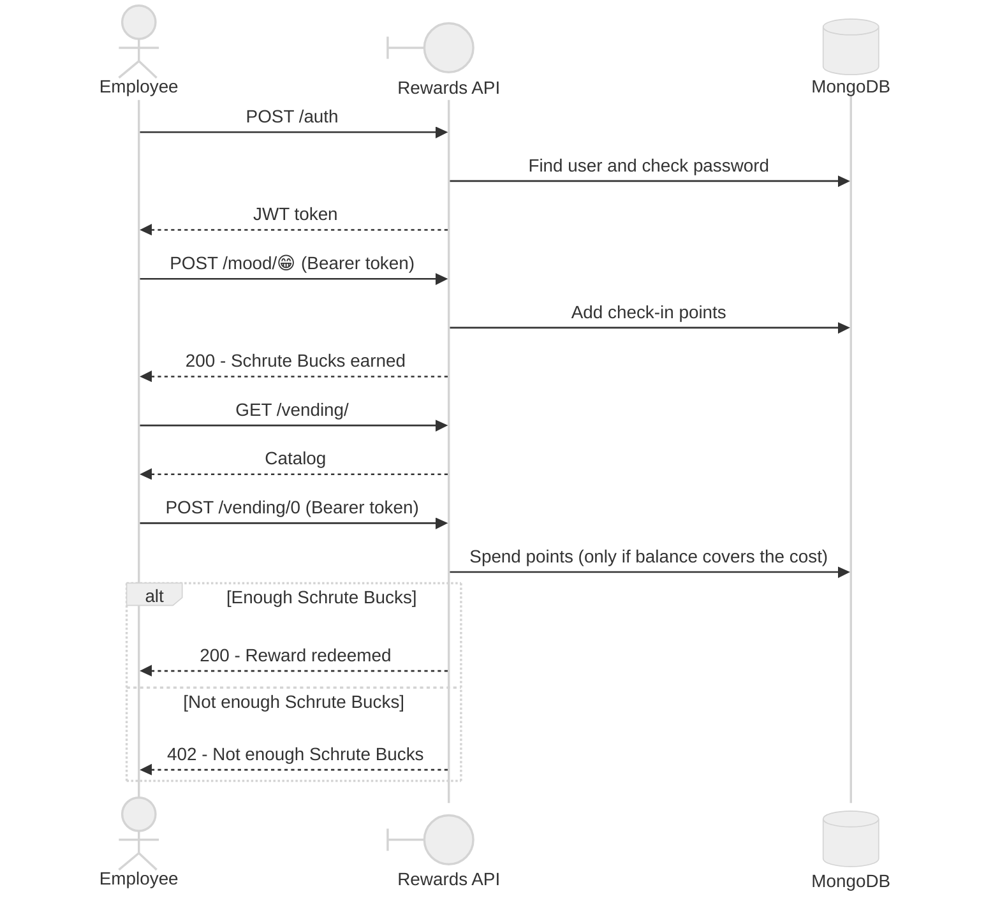
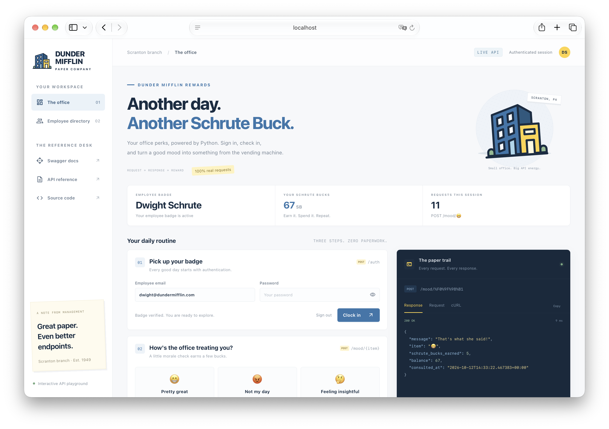

<div align="center">

# Rewards API


My goal with this repository is an in-depth exploration of FastAPI internals, the async execution model, and production-ready backend design.

**Schrute Bucks Rewards**, an employee rewards app inspired on "The Office" 📎

</div>

Part of [FastAPI Lab](../../README.md).



> [!NOTE]
> Start the API and check `http://127.0.0.1:8000`  
> The homepage has an interactive playground to run every endpoint live,
> plus copy-paste curl commands for each one.

<details>
<summary>Playground preview 👇</summary>



</details>

## Getting Started

### 💻 Run local

API on your machine, MongoDB in Docker.

```bash
# All commands run from the poc folder
cd pocs/rewards-api

# Install dependencies
make install

# Create the secrets file
echo "
[default]
TOKEN_SECRET_KEY = '$(openssl rand -hex 32)'
" > resources/.secrets.toml

# Start MongoDB, create the demo user, and run the API
docker-compose up -d mongo
make create-user
make run
```

### 🐳 Run in Docker

API and MongoDB both in Docker, using the `docker` profile from `resources/settings.toml`.

```bash
# All commands run from the poc folder
cd pocs/rewards-api

# Set the token secret (Dynaconf reads DYNACONF_* env vars, no secrets file needed)
export DYNACONF_TOKEN_SECRET_KEY="$(openssl rand -hex 32)"

# Build and start MongoDB and the API
docker-compose up -d --build

# Create the demo user (runs on your machine, MongoDB port is published)
make install
make create-user
```

> [!NOTE]
> Both modes use port 8000, so stop one before starting the other.

<details>
<summary>More commands: tests, formatting 👇</summary>

```bash
# Run tests
make test

# Format & lint (same checks as CI)
uvx pre-commit run --all-files

# Update locked dependencies
make update-deps
```

</details>

<details>
<summary>Project structure 👇</summary>

```text
.
├── app/
│   ├── main.py          # FastAPI app entrypoint
│   ├── routers/         # endpoints (auth, mood, vending, users)
│   ├── services/        # business logic
│   ├── infra/           # MongoDB client
│   ├── security.py      # JWT and password hashing
│   ├── dependencies.py  # Bearer token -> current user
│   ├── models.py        # Pydantic models
│   └── config.py        # Dynaconf settings loader
├── static/              # homepage with the interactive playground
├── resources/           # settings, Mongo init script, log config
├── scripts/             # one-off scripts (create demo user)
├── tests/               # unit tests
├── docker-compose.yml   # MongoDB and API containers
└── Dockerfile
```

</details>

## References

- [FastAPI: docs](https://fastapi.tiangolo.com/) — the framework this whole repo explores
- [pydantic: docs](https://docs.pydantic.dev/) — v2 data validation, used throughout `app/models.py`
- [uv: docs](https://docs.astral.sh/uv/) — dependency management
- [pre-commit: docs](https://pre-commit.com/) — hooks run in CI, see [`.pre-commit-config.yaml`](../../.pre-commit-config.yaml)
- [MongoDB: Quick Start FastAPI](https://www.mongodb.com/developer/quickstart/python-quickstart-fastapi/) — the ObjectId pattern in `app/models.py` follows this guide
